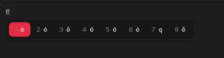
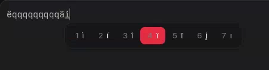

# Accent Hold

macOS-style press-and-hold accents for **GNOME on Wayland**, built with Python,
PyGObject and IBus. This prototype uses the native IBus candidate panel; no
GNOME Shell extension is required.

## Screenshots

Accent choices after holding `e`:



Selecting an alternative for `i`:



## Usage

Hold `e` for **500 ms** to open `è é ê ë ē ė ę ě`, then release it. Choose an
accent with a displayed number, the arrow keys followed by Enter, or a left
click. You can also **press the same letter again to cycle through accents**:
each new press advances one position, wrapping around after the last candidate.
Press Enter to confirm. Continuing to hold a key does not cycle automatically.

For example: hold `e` (highlighting `è`), release it, press `e` again
(highlighting `é`), then press Enter. Uppercase letters offer uppercase accents,
even if you release Shift before cycling.

Escape keeps the original letter. An ordinary key closes the menu, keeps the
original letter and continues typing. A quick tap is forwarded as an ordinary
key on release or before the next key, without starting text composition. This
preserves browser address-bar completion. During a long press, the temporary
**preedit text** appears only when the accent panel opens after 500 ms.
Quick uppercase taps insert the exact uppercase character directly, without
preedit, so Wayland clients cannot lose its case when Shift is released.

Only letters with alternatives lose their normal key repeat. Ctrl, Alt and
Super shortcuts pass through to IBus's simple engine, while AltGr can still
produce characters from the current layout. Dead keys and Compose sequences
are handled by IBus's simple engine.

## Requirements

- Python **3.10+**
- PyGObject and IBus 1.5 with GObject introspection data
- A running IBus session and applications that support text composition and
  forward key-release events and support asynchronous key forwarding

Use your distribution's system Python and PyGObject packages. A virtual
environment may not include the desktop's GObject introspection bindings.

## Install: step by step

Follow these steps from a terminal opened **inside your GNOME desktop session**.
The commands below use `/usr/bin/python3`, the system Python, to avoid missing
GObject bindings in a virtual environment or a separately installed Python.
You only need `sudo` for distribution packages, **not** for Accent Hold itself.

### 1. Check your desktop session

Run:

```sh
echo "$XDG_CURRENT_DESKTOP"
echo "$XDG_SESSION_TYPE"
```

The first result should include `GNOME` (for example, `GNOME` or `ubuntu:GNOME`)
and the second should be `wayland`. This guide targets GNOME on Wayland; other
desktops and X11 have not been validated by this project.

### 2. Install the dependencies

Choose **only the commands for your distribution**. On a regular GNOME desktop,
some of these packages may already be installed.

**Ubuntu / Debian:**

```sh
sudo apt update
sudo apt install git python3 python3-gi gir1.2-ibus-1.0 ibus
```

**Fedora Workstation:**

```sh
sudo dnf install git python3 python3-gobject ibus python3-ibus
```

**Arch Linux:**

```sh
sudo pacman -S --needed git python python-gobject ibus
```

These package-manager commands are for conventional package-based installations.
On an immutable/Atomic system, use your distribution's host-package workflow;
installing the dependencies only inside a container does not provide them to
the desktop engine.

Check Python and the IBus bindings:

```sh
/usr/bin/python3 --version
/usr/bin/python3 -c 'import gi; gi.require_version("IBus", "1.0"); from gi.repository import IBus; print("IBus bindings OK")'
```

You need Python **3.10 or newer**. The second command should print
`IBus bindings OK`. Resolve any import error before continuing.

Package references: [Ubuntu IBus dependencies](https://packages.ubuntu.com/noble/ibus),
[Fedora PyGObject](https://developer.fedoraproject.org/tech/languages/python/pygobject.html),
[Fedora IBus Python bindings](https://packages.fedoraproject.org/pkgs/ibus/python3-ibus/),
and [Arch IBus](https://archlinux.org/packages/extra/x86_64/ibus/).

### 3. Download Accent Hold

Open the directory where you want to keep the source, then run:

```sh
git clone https://github.com/Nekenlight/accent-hold.git
cd accent-hold
```

Run the remaining `run.py` and `tools/install.py` commands from **this repository
folder**. Keep the folder for later updates and uninstallation. If you already
have a clone, use the [update instructions](#update-an-existing-installation)
instead of cloning over it.

### 4. Check that IBus is reachable

```sh
/usr/bin/python3 run.py --check
```

The result should contain:

```text
IBus connected; PyGObject available
```

The actual line also includes the Accent Hold version. If you get
`IBus is unavailable`, see [troubleshooting](#troubleshooting) before proceeding.

### 5. Preview the installation, then install

First, show which files will be written without changing anything:

```sh
/usr/bin/python3 tools/install.py install --dry-run
```

Then install for your current user and refresh the IBus registry cache:

```sh
/usr/bin/python3 tools/install.py install --refresh-cache
```

**Do not run these two commands with `sudo`.** The installer copies the engine
into `~/.local/libexec/accent-hold/` and its descriptor into
`~/.local/share/ibus/component/accent-hold.xml`. It rebuilds your IBus registry
cache while including system engines and additional component paths. It does
not change your configured input sources or select Accent Hold for you.

The installer also adds a user systemd drop-in for GNOME's IBus service under
`~/.local/share/systemd/user/`. It supplies the component directories and asks
IBus to rescan them at startup. This keeps Accent Hold discoverable when a
system update invalidates the registry cache. See the
[IBus registry documentation](https://ibus.github.io/docs/ibus-1.5/IBusRegistry.html).
This persistent setup requires GNOME's `org.freedesktop.IBus.session.GNOME.service`;
other session launch mechanisms need their own configuration.

Installing identical files again is safe. If it reports
`Different installation found`, follow the update instructions rather than
overwriting files or deleting the installation manifest.

### 6. Log out and back in

Save your work, **log out of the GNOME session**, then log back in. Closing the
terminal or locking and unlocking the screen is not enough. This allows the
desktop to discover the newly registered input method.

### 7. Add and select the input source

1. Open **Settings → Keyboard**.
2. In **Input Sources**, click **Add Input Source** or the **+** button.
3. Look for **Accent Hold**. You may need to select **English**, open the
   additional languages list, or use the search field, depending on GNOME's
   version and language.
4. Select **Accent Hold**, then click **Add**.
5. Keep your regular keyboard source in the list.
6. In the top-bar input-source menu, select **Accent Hold**. You can also cycle
   through sources with **Super+Space** (`Super` is usually the Windows key).

Now run this in any terminal:

```sh
ibus engine
```

Expected output:

```text
accent-hold
```

If it shows another engine, select Accent Hold in the input-source menu and
check again. If you cannot find Accent Hold at all, see troubleshooting below.
The [GNOME input-source guide](https://help.gnome.org/gnome-help/keyboard-layouts.html)
explains the desktop's source picker and switching shortcuts.

### 8. Try your first accent

Open a text document or a normal text field in an application:

1. Tap `e` briefly: you should get one `e`.
2. Hold `e` for about half a second: the accent panel should appear.
3. Release `e`: the panel should stay open.
4. Press `2`: the original letter should become `é`.
5. Try again, but after releasing `e`, press `e` once more to highlight `é`,
   then press **Enter** to confirm.
6. Try **Escape** to keep the original letter, and **Shift+E** for uppercase
   alternatives.

Number shortcuts use the **digits produced by your layout**. If the number row
produces symbols, use Shift to type the digit, or use arrows and Enter instead.
The engine requests IBus's `default` layout and interprets symbols instead of
assuming QWERTY key positions; physical AZERTY/QWERTZ and multiple-layout
configurations still need broader desktop testing.

Switch back to your normal input source with Super+Space whenever you want
ordinary key-repeat behavior, including before playing games.

## Troubleshooting

**`No module named gi` or `Namespace IBus not available`**

Install the packages in step 2 for your distribution, then repeat the bindings
check. Use `/usr/bin/python3`, outside a virtual environment. Installing a
Python package with pip does not replace the desktop's IBus introspection data.

**`IBus is unavailable`**

Run the command in a terminal opened from the GNOME desktop, as your normal
user, without `sudo`. An SSH shell, container or unrelated session may not have
access to the desktop's IBus connection. If you just installed IBus, log out
and back in, then rerun step 4. Do not replace the desktop's daemon with an
unrelated IBus instance as part of this guide.

**Accent Hold is missing from Settings**

From the repository folder, rerun:

```sh
/usr/bin/python3 tools/install.py install --refresh-cache
```

Then log out and back in. Check the English and additional-language entries in
the source picker. If GNOME still hides the source, you can optionally show all
input sources:

```sh
gsettings set org.gnome.desktop.input-sources show-all-sources true
```

This changes the visibility of the source list, not the selected source. If it
was previously disabled, you can restore that setting afterward with:

```sh
gsettings set org.gnome.desktop.input-sources show-all-sources false
```

**The source is selected but there is no accent panel**

Check that `ibus engine` reports `accent-hold`. Try a document in a GTK text
editor and hold a supported letter such as `e` or `a`. Some applications bypass
input methods or do not forward key releases/preedit correctly. Password and
PIN fields and applications declaring a terminal input context deliberately do
not enable the picker. If one app fails, record its
version, your desktop session and keyboard layout when reporting the issue.

**`Different installation found` or `Existing unmanaged file`**

The installer refuses to overwrite another version or files it does not own.
For a managed installation, use the update steps below. If it reports an
unmanaged or modified file, inspect and back up that file before deciding what
to do; do not blindly delete it or the manifest.

## Update an existing installation

Switch to your regular keyboard source first. From your existing repository
folder, uninstall the old copy **before** downloading the new version:

```sh
/usr/bin/python3 tools/install.py uninstall --dry-run
/usr/bin/python3 tools/install.py uninstall
git pull --ff-only
/usr/bin/python3 tools/install.py install --dry-run
/usr/bin/python3 tools/install.py install --refresh-cache
```

Log out and back in to unload the old process and load the new code. Select
Accent Hold again; if you kept its input-source entry, you do not need to add
it a second time. A modified installed file makes the uninstall stop so you
can preserve your changes.

## Uninstall

1. Switch to your regular input source and remove **Accent Hold** from
   **Settings → Keyboard → Input Sources**.
2. From the repository folder, preview removal and then uninstall:

   ```sh
   /usr/bin/python3 tools/install.py uninstall --dry-run
   /usr/bin/python3 tools/install.py uninstall --refresh-cache
   ```

3. Log out and back in to unload the engine.

Only unchanged files recorded in the installation manifest are removed.
Additional files, including Python bytecode caches, are left alone. The IBus
cache is rebuilt; input-source preferences are not rewritten. Use `--prefix`
to test installation in a temporary directory.

## Compatibility and games

This is a prototype, not a universal keyboard interceptor. Applications that
bypass input methods are outside its coverage. Clients without preedit support
keep ordinary input without the accent picker. Clients requiring synchronous
key processing also keep ordinary input without the picker. Fields identified as passwords,
PINs or terminals do not activate it. Terminal input stays native automatically,
including at `sudo` prompts, which usually do not declare a separate password
context. This also preserves ordinary key repeat in terminal applications.
IBus/GNOME positions the panel using information
provided by the application.

**There is no automatic game detection or per-application exclusion yet.** A
game that forwards keys to an input-method context with preedit support could
trigger the picker. Switch to your regular input source before playing.
Terminal applications that do not declare their input context, Vim, games,
remote sessions and other compositors are outside the initial compatibility target.

Focus loss, reset or engine deactivation closes the menu and discards any
**uncommitted** letter to avoid inserting text into a different target.

See [validation coverage and the manual test checklist](docs/validation.md)
for the distinction between protocol tests and graphical application testing.

## Development

The logic and installer tests use the standard library and temporary folders:

```sh
python3 -m unittest discover -s tests -v
```

Integration tests run a **real IBus daemon on an isolated D-Bus session**, without
a display or changes to the desktop's input sources:

```sh
python3 tests/integration_ibus.py
python3 tests/integration_ibus.py --installed
```

An additional test uses GTK3/VTE in an offscreen window and an isolated IBus
session to check the actual bytes received by a pseudo-terminal, including
canonical no-echo input like a `sudo` prompt. It uses public test strings and
does not invoke `sudo` or access passwords. It requires GTK3, VTE introspection
bindings and an accessible X11/XWayland display (or `xvfb-run`):

```sh
python3 tests/integration_vte.py
```

These tests require `dbus-run-session`, `ibus-daemon` and PyGObject. The second
mode also checks file installation, the registry cache and automatic launch
through the XML descriptor, using an installation path containing spaces.

For temporary development registration, `python3 run.py --register` registers
the engine with the current IBus daemon until the process exits. Add
`--diagnostics` to print aggregate press, release, menu and commit counters at
exit. Typed text is not included; there is no keystroke log by default.

The code is separated into:

- `accent_hold/core.py`: a desktop-independent state machine accepting key,
  timeout, candidate-selection and reset events. It emits preedit, commit,
  candidate-display and timer actions.
- `accent_hold/variants.py`: ordered Latin alternatives, at most nine per letter.
- `accent_hold/ibus_engine.py`: IBus symbol/modifier translation, GLib timers,
  native candidate rendering and delegation to IBus's simple engine.

A future Fcitx5 adapter can reuse the core contract and accent tables, with its
own integration work. KDE, Sway and Hyprland support has not been validated.

API references: [IBus Engine](https://ibus.github.io/docs/ibus-1.5/IBusEngine.html)
and [GNOME Shell's IBus integration](https://gitlab.gnome.org/GNOME/gnome-shell/-/blob/main/js/misc/inputMethod.js).

## License

[MIT](LICENSE). An independent implementation inspired by the macOS interaction,
with no affiliation with Apple.
